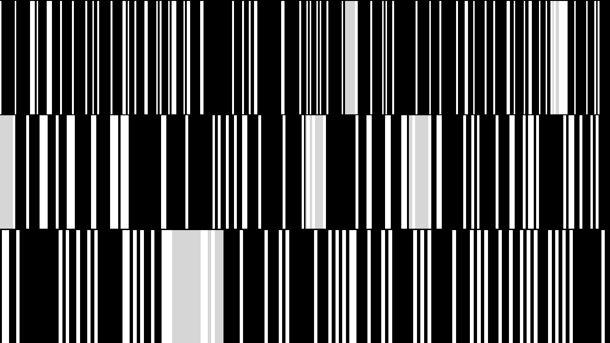
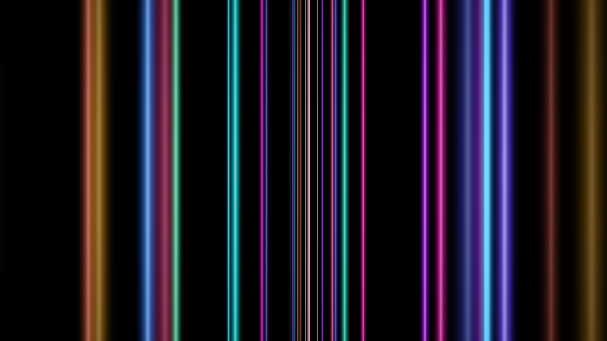

# Mekong

Real-time, audio-reactive visuals for projecting behind improvised guitar over drones.
Abstract, monochrome, data-driven (after Ryoji Ikeda): no waveforms, no EQ bars.

Mekong is a native macOS app. Plug in your instrument, put the visuals on a projector, and they follow what you play: loudness, brightness of tone, and every picked note.

 

## Download

Grab `Mekong-<version>.dmg` from the [latest release](https://github.com/socialspacedev/mekong/releases/latest), open it, and drag **Mekong** into Applications. It runs on Apple silicon and Intel Macs with macOS 14 (Sonoma) or newer.

Mekong isn't notarised by Apple, so the first time you open it macOS says it can't check it for malware. Click **Done**, then open **System Settings ▸ Privacy & Security**, scroll down and click **Open Anyway** next to the message about Mekong. Or, in Terminal:

    xattr -dr com.apple.quarantine /Applications/Mekong.app

To skip all that, build it yourself instead (below): an app compiled on your own Mac opens straight away.

## Build from source

    ./install.sh          # build and install to /Applications
    ./build.sh            # debug build + launch
    ./build.sh release    # optimised build → dist/Mekong.app
    ./test.sh             # run the tests
    ./release.sh          # universal build, packaged as a DMG for a GitHub release

## How it works

- **Scenes.** Barcode, Grid, Horizon, Interference, Scratch and Ribbons are built in. A sustained drone shapes them slowly; attacks (picked notes) are found against the drone, so a loud drone alone doesn't set them off. Change scenes with **1–9**, or let Mekong move on by itself every few minutes.
- **Look.** Density, motion, brightness and response (tight, or slow and smooth), with a white, tinted or inverted palette. Optional flashes on attacks are capped at three a second.
- **Input.** Any CoreAudio input, a single channel of a multi-channel interface, or the built-in test signal (a synthetic drone with plucks and rests, for trying it out with no instrument). Auto level follows your playing, a gate treats room noise as silence, and the visuals collapse like an old CRT when you stop.
- **Presenting.** **P** puts the visuals fullscreen on the projector (Automatic picks the screen without the menu bar), **Esc** takes them down, **Space** blacks out. The screensaver and display sleep are held off while presenting. If the projector drops out mid-set, the visuals go back up by themselves when it returns.
- **Your own scenes.** Drop pictures or `.metal` files into `~/Library/Application Support/Mekong/Scenes` (console ▸ Your scenes folder). They load live, so you can edit a scene while it's on the wall. `README.txt` in that folder explains the format. A file that doesn't compile, or clashes with the built-in scenes or another file, is listed with the reason and left out; the rest keep working.

The keys work while the console is in front. Your hands are on the guitar, so they're single presses with no modifiers.

## Good to know

- **Microphone permission.** macOS asks the first time Mekong listens. Audio is analysed live and never recorded or sent anywhere. Because builds aren't signed with a Developer ID, macOS may ask again after an update or rebuild.
- **One screen only?** Presenting on the only screen covers the console. The keys still work while Mekong is in front; if you switch away, switch back with ⌘-Tab and press **Esc**.
- **Heavy custom shaders** can slow the whole app, console included. Keep per-pixel loops short.

## Command line

    Mekong --snapshot <dir>    # render each scene from the test signal to PNG

Handy as a quick check that every scene, built-in and your own, still renders. Set `MEKONG_SCENES_DIR` to use a different scenes folder.

## Licence

MIT © 2026 Andrew Long. See [LICENSE](LICENSE).
